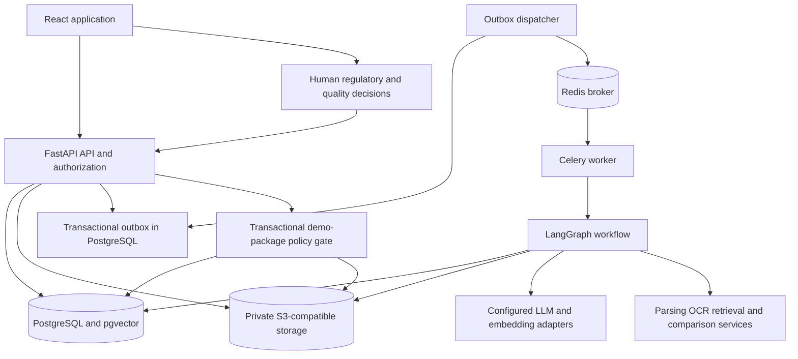
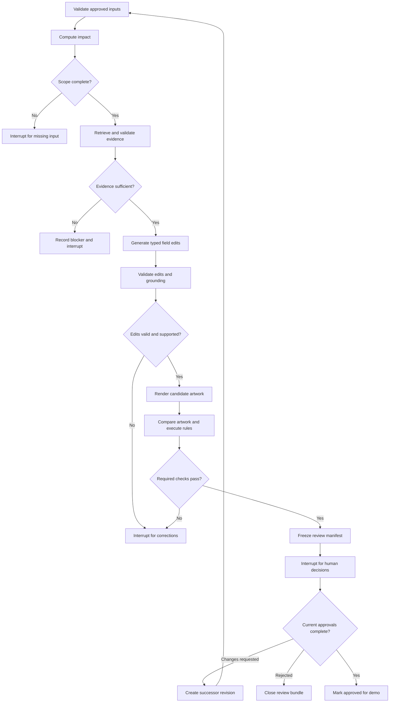

# Moora — Architecture

Status: proposed design for implementation. No application services, migrations, or model integrations exist yet.

Requirements: [PRD.md](PRD.md). Delivery order: [Phases.md](Phases.md). Implementation boundaries: [Rules.md](Rules.md).

## 1. Architecture decisions

1. Build a **modular Python backend** with an API process and a worker process, not eight independently deployed agent services.
2. Use LangGraph for bounded workflow transitions, durable checkpoints, and human interrupts. Use Celery for delivery/execution of background jobs, not as a second business-state machine.
3. Keep approval policy, rule execution, versioning, rendering, and package authorization deterministic. LLM output is a proposal that must pass typed validation.
4. Store authoritative domain state in PostgreSQL, immutable binary artifacts in private S3-compatible storage, and transient broker/cache data in Redis.
5. Use PostgreSQL + pgvector for vectors and an actual BM25 implementation for the lexical retrieval branch. PostgreSQL full-text ranking must not be described as BM25.
6. Use a fixed-template PDF renderer for the MVP. Compare the rendered PDF that will be reviewed, not an unrelated text draft.
7. Freeze each run's product, knowledge, rules, templates, and model/prompt configuration. Bind approvals to a hashed review manifest.
8. Restrict the MVP to demonstration packages. Production release requires a separate future design and validation effort.

## 2. System topology



For local development, Docker Compose will start PostgreSQL/pgvector, Redis, and an S3-compatible development server such as MinIO. Start the API, worker, dispatcher, and frontend as documented processes. Services may later run in containers behind a TLS reverse proxy. The deployment region and provider are undecided.

No public bucket, unauthenticated artifact URL, or browser-to-model-provider connection is permitted. Browser downloads use an authenticated API authorization step and short-lived object access where appropriate.

## 3. Selected stack

| Layer | Choice | Reason and constraints |
| --- | --- | --- |
| Frontend | React, TypeScript, Vite | A client application with a separate API fits the brief without requiring server-side rendering. |
| UI | Tailwind CSS, shadcn/ui with Radix primitives, Lucide icons | Accessible primitives and a small consistent component set. Review library licenses and keyboard behavior. |
| Client data | TanStack Query; React Router | Server-state caching and route-level screens; do not duplicate authoritative workflow state in a global store. |
| Forms | React Hook Form + Zod | Typed field validation; API validation remains authoritative. |
| API | Python 3.12 target, FastAPI, Pydantic v2 | Typed requests, responses, model outputs, and OpenAPI. Verify supported dependency versions during scaffolding. |
| Persistence | SQLAlchemy 2, Alembic, Psycopg 3 | Explicit transactions and reviewed migrations. |
| Workflow | LangGraph + PostgreSQL checkpointer | Durable state and interrupt/resume behavior. |
| Model integration | Narrow LangChain/provider adapters | Only use integrations needed for prompts, embeddings, and retrieval; avoid hidden autonomous behavior. |
| Jobs | Celery + Redis | Background execution with bounded concurrency and retriable delivery. |
| Data | PostgreSQL 16 target + a compatible pinned pgvector build | Relational lineage, access filtering, and vector retrieval together. Verify image compatibility before pinning. |
| Lexical search | `rank-bm25` over a bounded authorized corpus partition | True BM25 without adding another server for the student MVP. Scale later through a tested BM25-capable service/extension. |
| Reranking | A pinned English cross-encoder through `sentence-transformers` | Select model, weights, resource budget, license, and integrity checks before installation. |
| PDF/OCR | PyMuPDF behind an adapter, Tesseract OCR | Verify PyMuPDF's AGPL/commercial licensing fit before use; PDFium via `pypdfium2` is the planned alternative if needed. |
| Artwork | OpenCV, `zxing-cpp` barcode decoding, ReportLab rendering | Deterministic image/geometry/barcode operations and controlled PDF generation. |
| Object storage | S3 API through boto3; MinIO candidate for local use | Private versioned objects; review server licensing before redistribution. |
| Authentication | Opaque PostgreSQL-backed browser sessions; Argon2id password hashes | Local demo identities initially; enterprise OIDC is a later adapter. |
| Testing | pytest, httpx, Vitest/Testing Library, Playwright | Unit, service integration, accessibility, and end-to-end checks. |
| Quality tools | Ruff, mypy for core backend code, ESLint, TypeScript checks | Keep deterministic boundaries and typed contracts inspectable. |
| Tooling | Node.js 24 target, npm workspaces, uv Python workspace | One root `package-lock.json` and one `uv.lock`; exact versions are pinned in Phase 1. |

These are planned dependencies, not claims that they are installed. Do not put speculative exact package versions into a lockfile. Document extraction and model choices remain subject to licensing and compatibility checks.

## 4. Application flow and trust boundaries

```mermaid
flowchart LR
    Product[Approved product revisions] --> Change[Change request]
    Change --> Impact[Impact analysis]
    Impact --> Evidence[Applicable evidence retrieval]
    Evidence --> Draft[Structured draft edits]
    Draft --> Render[Versioned template rendering]
    Render --> Checks[Artwork and deterministic checks]
    Checks --> Bundle[Immutable review manifest]
    Bundle --> RA[Regulatory reviewer]
    Bundle --> QA[Quality reviewer]
    RA --> Gate[Recheck policy and freshness]
    QA --> Gate
    Gate --> Package[Watermarked demo package]
```



The API authenticates the actor, enforces object/organization permissions, validates input, and persists a job plus outbox record in one database transaction. A dispatcher publishes committed jobs to Celery. An event is marked sent after publication; duplicate publication is expected and workers deduplicate side effects.

Extracted PDFs, OCR text, retrieved passages, product uploads, and model output are untrusted data. They cannot redefine system instructions, expand network permissions, select arbitrary tools, or grant approval authority. RAG contexts are authorized and filtered before they reach a model or reranker.

## 5. Eight roles mapped to implementation

| Brief role | MVP implementation | Later extension |
| --- | --- | --- |
| Change Impact Analysis Agent | Dependency service plus constrained explanation node | Reviewed mappings from real ERP/PLM connectors |
| Regulatory Intelligence & RAG Agent | Retrieval subgraph with applicability checks and citations | More jurisdictions and authorized update monitoring |
| GenAI Label Authoring Agent | Typed field-edit generation and grounding checks | More approved label templates and content types |
| Computer Vision Validation Agent | Deterministic comparison pipeline, with optional narrative explanation | More formats and validated symbol/layout detectors |
| Compliance Verification Agent | Versioned rule engine; AI observations remain advisory | Validated jurisdiction/device-specific rule packs |
| Multilingual Translation Agent | Reserved interface; outside the core MVP | One source/target language pilot with glossary, translation memory, and qualified review |
| Quality & Audit Agent | Event, lineage, manifest, and report services | Retention controls, signed exports, external QMS integration |
| Human Review Coordination Agent | Role/qualification policy and workflow interrupts | Enterprise reviewer routing and validated signature integration |

An agent is a bounded task with typed inputs and outputs. It does not imply an independently autonomous service, a different LLM, or authority to approve its own work.

### Artwork validation service

Compare an immutable baseline artifact with the candidate artifact from the same proposed label revision. The pipeline extracts native text, applies OCR where needed, rasterizes each page at a recorded resolution, and computes documented alignment transforms. Preserve original page coordinates so every finding can be reproduced.

Run separate checks for field text, missing content, units/identifiers, required template regions, licensed symbol references, bounding-box changes, image differences, and decoded barcode payloads. Compare barcode values with approved expected data; decoding does not validate registry status or print quality. A layout shift can be an intended change or a defect, so keep raw observations separate from rule severity and reviewer disposition.

Store regions as normalized top-left-origin page coordinates with the page number, source dimensions, and render/alignment transform. Use annotated fixtures to confirm overlays and findings map back to the correct page. Required checks that lack sufficient extraction quality or format support return a blocking `NOT_EVALUATED` or `ERROR` outcome. A high image-similarity score alone cannot mark the artwork safe.

## 6. Advanced RAG

### 6.1 Controlled ingestion

1. Upload a permitted PDF/document into quarantine. Verify size, MIME/magic bytes, page limits, and file hash. Parse in a restricted worker with resource limits; reject active content and unsupported/encrypted files unless an explicitly supported safe path exists.
2. Create a `source_document` identity and immutable `document_version`. Record issuer, source URL if applicable, title, jurisdiction, device/subject scope, publication/effective dates when known, imported date, rights classification, and authorized organization/access scope.
3. Extract native text, page numbers, headings, tables, and bounding boxes. Run Tesseract only where native extraction is absent or insufficient. Preserve page images and OCR quality diagnostics.
4. Require knowledge-steward review of uncertain extraction, rights, version status, and applicability metadata. Unknown effective dates stay unknown; they are not inferred from the file timestamp.
5. Segment by section and paragraph boundaries. Use parent sections and child semantic chunks, initially about 300–600 tokens with a small overlap. Preserve tables, warnings, units, and source ordering; tune on evaluation data.
6. Store normalized text alongside original page/region anchors and content hashes. Chunk IDs are stable only within an immutable document version.
7. Embed chunks with a recorded model/profile and fixed dimension. Store BM25 tokenization inputs and the same versioned chunk IDs.
8. Publish a knowledge snapshot only when required checks pass. Supersede old source versions explicitly, retaining historical evidence for prior runs.

Do not automatically crawl arbitrary URLs, scrape licensed standards, or redistribute restricted full-text sources. For sources whose rights prohibit external processing, use a permitted local model or block that processing step.

### 6.2 Retrieval pipeline

1. Derive a typed retrieval context from approved product metadata, the changed fields, evidence jurisdiction, language, and assessment date. Missing required applicability fields return `NEEDS_INPUT`.
2. Build a bounded rewritten query set. Preserve the original question and protected identifiers; rewriting must not silently change jurisdiction, device classification, or assessment date.
3. Filter the candidate corpus by organization/access rights, published snapshot membership, jurisdiction, subject scope, language, and permitted version/effective date. Cross-jurisdiction material is considered only through an explicit recorded applicability path.
4. Run BM25 and pgvector similarity retrieval over that authorized scope, initially up to 40 candidates per branch. For a small filtered corpus, exact vector search is acceptable and easier to validate; introduce HNSW only when measured scale needs it.
5. Fuse candidates using reciprocal rank fusion, deduplicate by versioned chunk ID, and rerank the bounded union with the pinned cross-encoder.
6. Select up to eight evidence chunks from the reranked results, with relevant parent context under a token budget. These initial sizes are tunable configuration, not guarantees of accuracy.
7. Validate every citation reference against stored hits. Run support and contradiction checks and produce one of `SUFFICIENT`, `INSUFFICIENT`, `CONFLICTING`, or `NEEDS_INPUT` with reasons.
8. Persist retrieval context, candidates, scores by stage, filters, model/configuration versions, chosen sources, and the final evidence result.

For the MVP, `rank-bm25` loads at most 5,000 authorized chunks per corpus partition. Cache keys include organization, access scope, knowledge snapshot, language, tokenizer version, and candidate-set fingerprint. Invalidate on permission or source changes. Exceeding the bound is a visible unsupported-capacity condition, never silent truncation. This limit keeps the prototype practical; it is not the enterprise search design.

BM25 scores, cosine similarity, and cross-encoder scores are different quantities and are not calibrated probabilities. Thresholds must be established on labeled cases. LLM-based grounding checks can help triage but cannot prove a claim true.

### 6.3 Evidence contract and updates

Each evidence reference includes:

- `document_version_id`, `chunk_id`, and the excerpt hash.
- Human-readable document title and issuer.
- PDF page number (one-based), optional printed page label, section path, and region where available.
- Source revision, publication/effective dates if known, and the assessment date.
- Applicability rationale and the claim/label-field IDs it supports.
- Access restrictions and the knowledge snapshot ID.

A newer source version creates a new snapshot. Affected in-flight review bundles become stale pending a recorded applicability/revalidation decision. Historical decisions and packages retain their original source references. If a source is revoked or access is removed, prevent further unauthorized retrieval and follow the applicable retention policy for existing artifacts.

### 6.4 Evaluation

Keep a frozen evaluation set of answerable, insufficient-evidence, conflicting-version, wrong-jurisdiction, and unauthorized-source queries. Measure recall@10, citation resolution, human-scored citation support, abstention, latency, and cost. Separate retrieval failure from generation failure. Do not train or tune on held-out cases without identifying the resulting evaluation contamination. Targets are in [PRD.md](PRD.md).

## 7. LangGraph orchestration

### 7.1 State contract

Use a typed state containing references and small structured results, not entire PDFs or source corpora:

```text
WorkflowState
  schema_version, organization_id, run_id, change_request_id
  initiating_actor_id, thread_id, correlation_id
  product_revision_ids, label_revision_ids, template_version_ids
  assessment_context, knowledge_snapshot_id, rule_set_version_id
  prompt_version, model_profile_id, tool_versions
  input_manifest_hash, affected_label_ids, impact_result_ref
  evidence_status, evidence_set_ref, proposed_edit_refs
  rendered_artifact_refs, validation_result_refs, finding_ids
  review_bundle_id, review_manifest_hash, review_task_ids
  status, attempt_counts, iteration_count, last_error
```

Secrets and authentication cookies never enter graph state, checkpoints, prompt logs, or reports.

### 7.2 Nodes and conditional routes



Input resolution resumes from the last valid dependency boundary. A content, source, template, or rule change invalidates affected downstream outputs; it must not simply resume at packaging. A maximum of two automatic draft-repair attempts is allowed; further correction requires explicit user action. No open-ended agent conversation loops.

### 7.3 Durable execution

- Use the PostgreSQL checkpointer with a unique thread per run. Acquire a PostgreSQL advisory lock or equivalent lease so only one executor mutates a run at a time.
- Node side effects have a unique key such as `(run_id, node_name, input_manifest_hash, implementation_version)`. Replayed nodes reuse committed outputs after checking their hashes.
- Domain writes and checkpoint writes may use separate transactions. Reconcile them through node execution records and idempotency; do not assume a single atomic transaction across LangGraph, PostgreSQL, Redis, and object storage.
- Commit generated artifacts to immutable object keys and record their hashes. If a worker dies after upload but before recording, retry safely and clean unreferenced objects through a documented retention job.
- Network/provider retries use timeouts and exponential backoff with jitter, up to three attempts for transient failures. Authentication, rights, schema, and evidence failures are not blind-retry conditions.
- Human interrupts persist state and release the worker. Reviewers submit decisions to the API, which checks authorization and freshness, then enqueues the permitted resume action. The browser never directly resumes arbitrary LangGraph nodes.
- Poll a run-status endpoint initially. Streaming progress is optional after the workflow is correct.
- Treat Redis as replaceable delivery infrastructure; the database/outbox must allow recovery if broker state is lost.

Run states are `QUEUED`, `RUNNING`, `WAITING_FOR_INPUT`, `WAITING_FOR_REVIEW`, `REVALIDATION_REQUIRED`, `BLOCKED`, `COMPLETED`, `FAILED`, and `CANCELLED`. A completed analysis run does not imply an approved bundle.

## 8. Data model

Every organization-owned table has `organization_id`, an immutable UUID primary key, and creation timestamps. Enforce organization relationships using composite constraints or equivalent validated associations; an organization column alone is not access control. Add SQL row-level security before claiming robust multitenant isolation. Immutable content revisions are insert-only through the application.

| Tables | Important fields and relationships |
| --- | --- |
| `organizations`, `users`, `memberships` | Organization membership, role assignments, account status; users may belong to an organization only through explicit membership. |
| `reviewer_qualifications`, `sessions` | Reviewer scope/validity; hashed opaque session identifiers, expiration, and revocation. |
| `products`, `product_revisions` | Stable product identity; revision number, validated data JSON, approval reference, schema version, content hash. Unique `(product_id, revision_number)`. |
| `label_templates`, `template_versions` | Approved field definitions, layout metadata, source object, rights, content hash. |
| `labels`, `label_revisions` | Stable variant/market/packaging/language identity; immutable field content, product revision, template version, predecessor, and rendered artifact. |
| `dependency_edges` | Product field/revision scope to affected label/template field; provenance, mapping version, reviewer, and status. |
| `change_requests`, `affected_labels` | Before/after product revisions, changed fields, reason, submitter; affected label and dependency-path evidence. |
| `source_documents`, `document_versions` | Stable source identity; immutable revision, issuer, source URL, rights, dates, applicability metadata, object hash, publication status. |
| `knowledge_snapshots`, `knowledge_snapshot_members` | Immutable authorized source-version set used by a run. |
| `document_chunks` | Document version, parent chunk, section path, page/region anchors, text/hash, token count, embedding profile, embedding vector. |
| `retrieval_runs`, `retrieval_hits` | Query context, snapshot and filters; candidate chunk IDs, branch scores, ranks, and selection decisions. |
| `evidence_sets`, `evidence_references` | Evidence status, applicability decisions, selected hits, excerpt hashes, and source anchors. |
| `draft_edits`, `claim_links` | Label revision, field path, previous/proposed value, product fact refs, approved-text refs, and evidence refs. |
| `approved_text_blocks`, `rule_sets`, `rule_versions` | Versioned source wording and deterministic predicates, applicability conditions, severity, and their supporting authority. |
| `workflow_runs`, `node_executions`, `run_events` | Input manifest, graph/model/configuration versions, status, idempotent node outputs, and progress events. |
| `validation_runs`, `findings` | Label/artifact/rule/evidence versions, checker versions, status; severity, category, region, source, and disposition. |
| `review_bundles`, `review_bundle_items` | Change/run identity, immutable manifest and hash, included label/evidence/check revisions, effective status. |
| `review_tasks`, `review_decisions` | Required role and qualification scope; human identity, decision, rationale, manifest hash, and decision time. |
| `artifact_objects`, `demo_packages` | Private object key, MIME type, hash, size, rights; package manifest, approval refs, and output hashes. |
| `audit_events` | Actor type/ID, organization, entity/revision, event type, correlation ID, safe metadata, sequence, and linked event hashes. |
| `outbox_events`, `idempotency_records` | Transactional work delivery; organization/actor/route/key, request hash, effective result, and expiry policy. |
| Later: `glossaries`, `glossary_entries`, `translation_memory`, `translation_reviews` | Approved terminology, source/target segments, revision provenance, and qualified locale reviews. |

The embedding column has a fixed dimension `D` selected with the Phase 3 embedding profile. `vector(D)` here is design notation, not executable SQL. A model/dimension change requires an explicit migration/index namespace and re-embedding; incompatible vectors must never be silently mixed.

Key lineage: product revision → change request → affected label → draft edit → evidence reference → document chunk/version; label revision → artifact → validation findings → review manifest → human decisions → demo package.

Store UTC instants as timezone-aware timestamps. Keep regulatory effective dates as dates when the source provides no time. Render user-facing times using the user's selected timezone without changing the stored event order.

## 9. Review state and authorization

Review bundle states:

```text
DRAFT → READY_FOR_REVIEW → APPROVED_FOR_DEMO → PACKAGED_FOR_DEMO
                         ↘ CHANGES_REQUESTED → successor DRAFT
                         ↘ REJECTED
Any affected active bundle → STALE → revalidation/new manifest
```

Content and manifest revisions are immutable; effective bundle status may change through audited transitions. Previous approval decisions are retained even when no longer effective. Labels derive approval from bundle membership and current decisions, not from a mutable standalone `approved=true` field.

The package gate checks, in one locked database transaction:

1. Requester authorization and organization membership.
2. Expected manifest/version token and absence of newer applicable changes.
3. Complete required checks with no critical/major finding or other blocking status.
4. Minor/advisory dispositions and sufficient current evidence.
5. Effective regulatory and quality decisions by distinct qualified humans, excluding the submitter.
6. Object and revision hashes matching the approved manifest.
7. An idempotent package request, recorded for asynchronous assembly.

The assembler rechecks the immutable authorized manifest and verifies generated package hashes before making the package available. Source revocation or a new invalidation between authorization and completion must prevent download until reviewed. Final availability is a transactional state change, not simply a successful object upload.

Packages contain artifact hashes, approved label PDFs, permitted report content, decisions, and source references. Include excerpts or original source documents only where their rights and the recipient's access permit export. A complete lineage manifest does not require redistributing a licensed source's full text.

## 10. API and typed contracts

Prefix all endpoints with `/api/v1`. Use UUIDs, ISO 8601 timestamps, cursor pagination, and explicit enums. The server generates organization context from the session; callers cannot select an arbitrary organization through an unchecked request field.

| Endpoint | Purpose |
| --- | --- |
| `POST /auth/login`, `POST /auth/logout`, `GET /auth/me` | Create/revoke a session and obtain current identity/roles. |
| `GET /products`, `GET /products/{id}/revisions` | List authorized product data and revision history. |
| `POST /products/{id}/revisions` | Import a validated revision and its approval metadata through a controlled role. |
| `GET /labels`, `GET /labels/{id}/revisions` | Retrieve scoped labels and immutable history. |
| `POST /change-requests`, `GET /change-requests/{id}` | Create and inspect a typed product change. |
| `POST /change-requests/{id}/runs` | Enqueue analysis; return `202` and a run ID. |
| `GET /runs/{id}`, `GET /runs/{id}/events` | Status and bounded event polling. |
| `POST /runs/{id}/input-resolutions`, `POST /runs/{id}/cancel` | Supply permitted missing input or request cancellation; no arbitrary node execution. |
| `POST /knowledge/documents`, `GET /knowledge/documents/{id}` | Upload controlled knowledge and inspect ingestion state. |
| `POST /knowledge/document-versions/{id}/publish` | Publish reviewed extraction/applicability metadata into a new knowledge snapshot. |
| `GET /evidence-sets/{id}`, `GET /evidence-references/{id}` | Read authorized evidence and citations. |
| `POST /labels/{id}/draft-revisions` | Create a successor draft from structured edits; never overwrite reviewed content. |
| `GET /label-revisions/{id}/comparison`, `GET /validation-runs/{id}/findings` | Artifact comparison and check results. |
| `POST /findings/{id}/dispositions` | Record permitted nonblocking finding disposition with rationale. |
| `POST /review-bundles`, `GET /review-bundles/{id}` | Freeze a validated run into a review manifest and inspect it. |
| `GET /review-tasks`, `POST /review-tasks/{id}/decisions` | Review queue and authorized human decisions. |
| `POST /review-bundles/{id}/demo-package` | Request a policy-gated demo export; no production-release route. |
| `GET /demo-packages/{id}`, `GET /artifacts/{id}/download` | Package status and authorized downloads. |
| `GET /audit-events` | Scoped, paginated event inspection. |
| `GET /health/live`, `GET /health/ready` | Liveness and required database/broker/storage connectivity; do not disclose secrets or call a paid model. |

Essential Pydantic models:

| Model | Key fields and validation |
| --- | --- |
| `ChangeRequestCreate` | `product_id`, `before_revision_id`, `after_revision_id`, `reason`; derive and verify field changes server-side. |
| `AssessmentContext` | Jurisdiction, device/subject classification, packaging level, source language, assessment date; required applicability fields cannot be silently defaulted. |
| `ImpactResult` | Affected label IDs, dependency paths, mapping version, unresolved relationships. |
| `EvidenceReference` | Document/chunk versions, location, excerpt hash, applicability rationale; reject references outside the authorized retrieval result. |
| `EvidenceSet` | Status enum, evidence references, unresolved questions, conflict records. |
| `DraftEdit` | Allowed field path, previous/proposed value, provenance references; preserve identifiers/units and forbid unsupported fields. |
| `Finding` | Severity, category, `PASS`/`FAIL`/`NOT_EVALUATED`/`ERROR` outcome where relevant, source/checker, artifact region, and blocking reason. |
| `ReviewDecisionCreate` | `APPROVE`, `REJECT`, or `REQUEST_CHANGES`, expected manifest hash, rationale; actor/role are server-derived. |
| `DemoPackageRequest` | Expected manifest hash and output selection constrained to approved items. |
| `ApiError` | Stable code, safe message, field details, correlation ID, and `retryable` flag. |

Use `Idempotency-Key` for job creation, decisions, and packaging. Reusing a key with a different request body returns a conflict. Use `If-Match`/ETag or an equivalent required version token for revision-sensitive transitions. Stale state returns `409`; unauthorized actions return `401`/`403`, and inaccessible objects may return `404` to avoid disclosure. Schema violations return `422`. Sensitive details and stack traces stay out of client errors.

## 11. Planned repository structure

The following tree is a **target structure**. At documentation creation time, only `README.md` and the six planning documents exist.

```text
Moora/
├── README.md
├── PRD.md
├── Architecture.md
├── Rules.md
├── Phases.md
├── Design.md
├── Memory.md
├── package.json                 # npm workspace and shared frontend scripts
├── package-lock.json
├── pyproject.toml               # uv workspace and Python quality settings
├── uv.lock
├── .env.example                 # names and safe examples, never credentials
├── apps/
│   ├── web/
│   │   └── src/
│   │       ├── app/             # router, providers, page shell
│   │       ├── api/             # client and generated OpenAPI types
│   │       ├── components/ui/   # shared accessible primitives
│   │       ├── features/        # products, changes, evidence, review, audit
│   │       └── styles/          # design tokens and base styles
│   └── api/
│       └── src/moora_api/
│           ├── routes/
│           ├── auth/
│           ├── dependencies/
│           └── main.py
├── packages/
│   └── domain/
│       └── src/moora_domain/
│           ├── models/         # SQLAlchemy entities
│           ├── schemas/        # Pydantic contracts
│           ├── services/       # revisions, evidence, reviews, packaging
│           ├── policies/       # authorization and approval predicates
│           ├── repositories/   # scoped database operations
│           └── adapters/       # model, document, storage, and source interfaces
├── services/
│   └── worker/
│       └── src/moora_worker/
│           ├── graph/          # state, nodes, routes, checkpoints
│           ├── tasks/          # Celery entry points and outbox delivery
│           ├── ingestion/
│           ├── retrieval/
│           ├── authoring/
│           ├── vision/
│           └── reporting/
├── migrations/                 # Alembic versions
├── infra/                      # Compose, Dockerfiles, deployment examples
├── scripts/                    # reproducible dev, seed, and evaluation commands
├── tests/
│   ├── unit/
│   ├── integration/
│   ├── e2e/
│   └── fixtures/               # synthetic data and permitted tiny samples
├── evals/                      # manifests, labeled queries, comparison truth sets
└── docs/decisions/              # material architecture decision records
```

Commit synthetic fixture definitions and rights metadata. Do not commit real restricted documents, generated evidence indexes, model weights, access tokens, database dumps, or large artifact outputs.

## 12. Security, configuration, and operations

- Configure `DATABASE_URL`, `REDIS_URL`, object-store endpoint/bucket credentials, session configuration, model profiles, and provider credentials through environment settings or local ignored configuration. Exact names are finalized with adapters. Never put actual credentials in these documents or fixtures.
- Use the platform's existing Git/proxy authentication and inherited CA trust. Resolve destination/credential policy through environment settings; do not disable TLS or extract injected credentials.
- Scope model calls to permitted source material. Provider outage must produce a blocked/failed live run; an explicitly labeled fixture replay is a separate mode and cannot silently replace it.
- Use HttpOnly, SameSite cookies, Secure cookies under HTTPS, session rotation, login rate limiting, origin checks, and session-bound CSRF protection for mutating requests. Never store session credentials in browser local storage. Development cookie exceptions must be local-only configuration.
- Enforce organization/role checks in API routes, background job input loading, retrieval, evidence views, and object downloads. Workers recheck permissions where a delayed action may outlive a grant.
- Use structured redacted logs with run IDs and per-node timing. Audit summaries may store hashes and approved metadata; full model prompts or restricted passages need separate controlled storage and retention rules.
- Give the application database role insert-only access to audit events. A per-organization sequence/hash chain can reveal some tampering; database administrators remain a trust boundary. Do not call this tamper-proof or equivalent to a validated signature system.
- Restrict uploads and source URLs to allowed operations and destinations; block SSRF, parser resource exhaustion, arbitrary file access, and executable document instructions.
- Keep dev seed data idempotent. Schema migrations are explicit; never drop user data automatically to fix setup.
- Monitor job backlog, failure categories, OCR quality, evidence abstention, model cost, and stale bundles. A green process health check does not establish regulatory or functional correctness.

## 13. Delivery and unresolved choices

The build order is foundation → product revisions and impact → controlled evidence/RAG → drafting/artwork → approval/audit/package → measured demo. [Phases.md](Phases.md) defines the exit gates.

Still open: provider/model names, embedding dimension, reranker license/model, source corpus rights, PyMuPDF licensing fit, final reviewer qualification process, delivery dates, deployment region, and future ERP/PLM APIs. Resolve choices at the relevant phase gate; do not treat this architecture as evidence that they are already configured.
